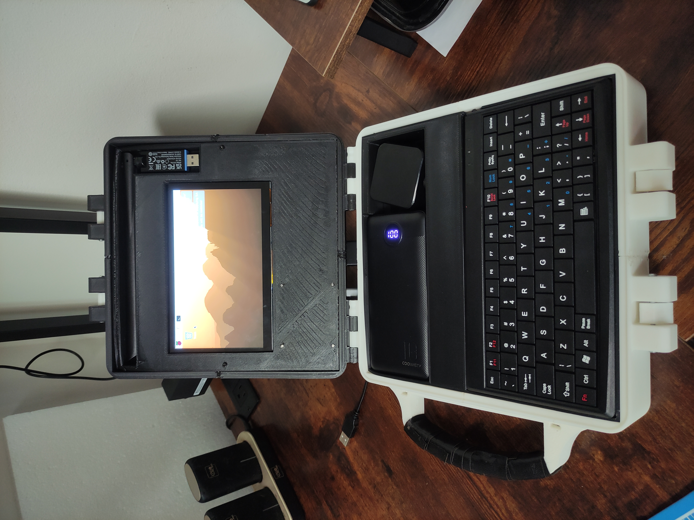
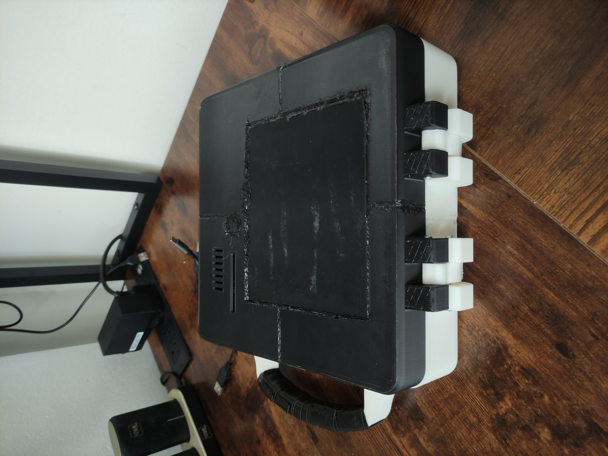
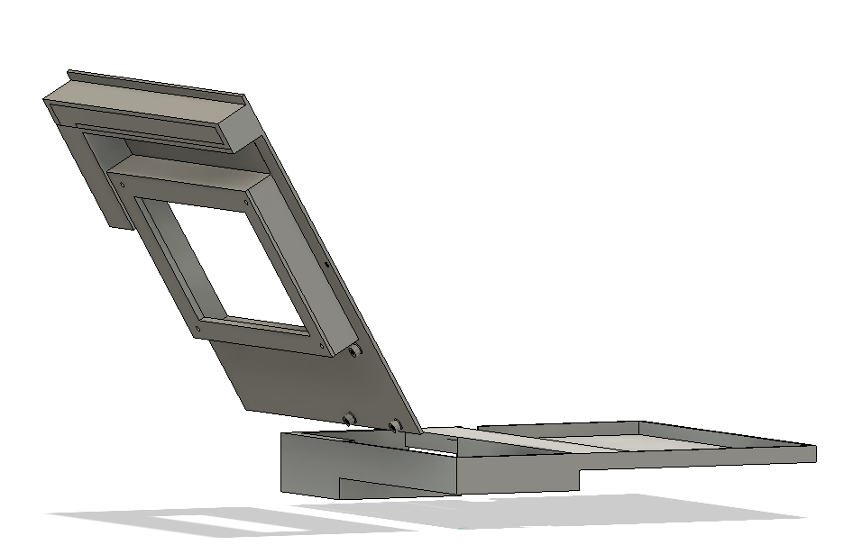
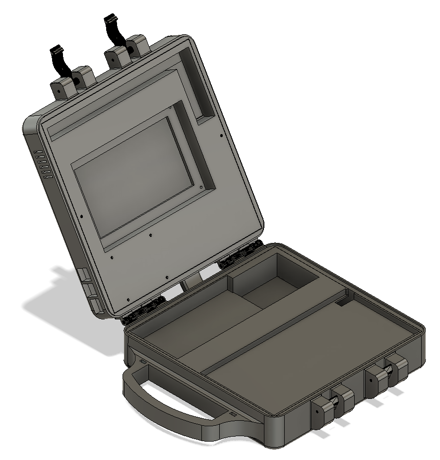
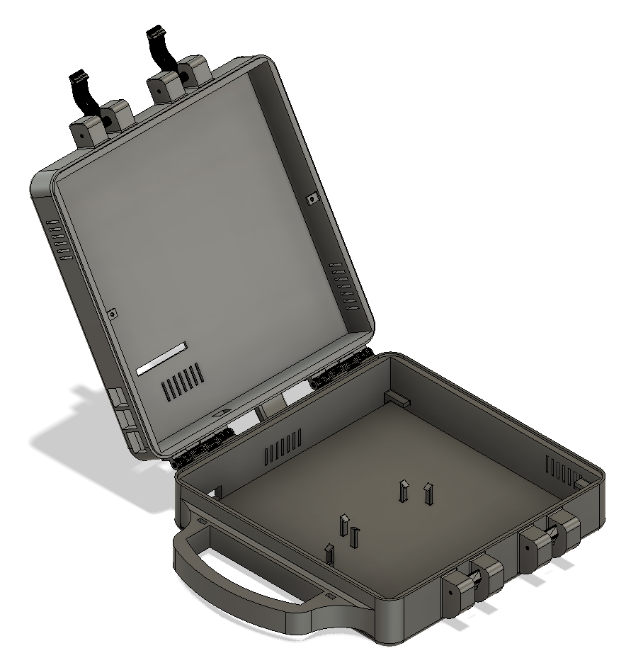
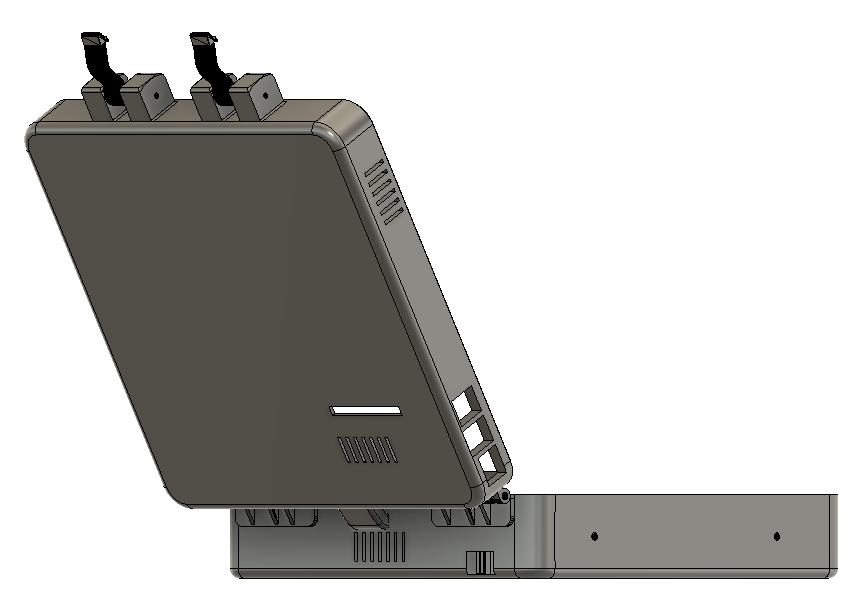
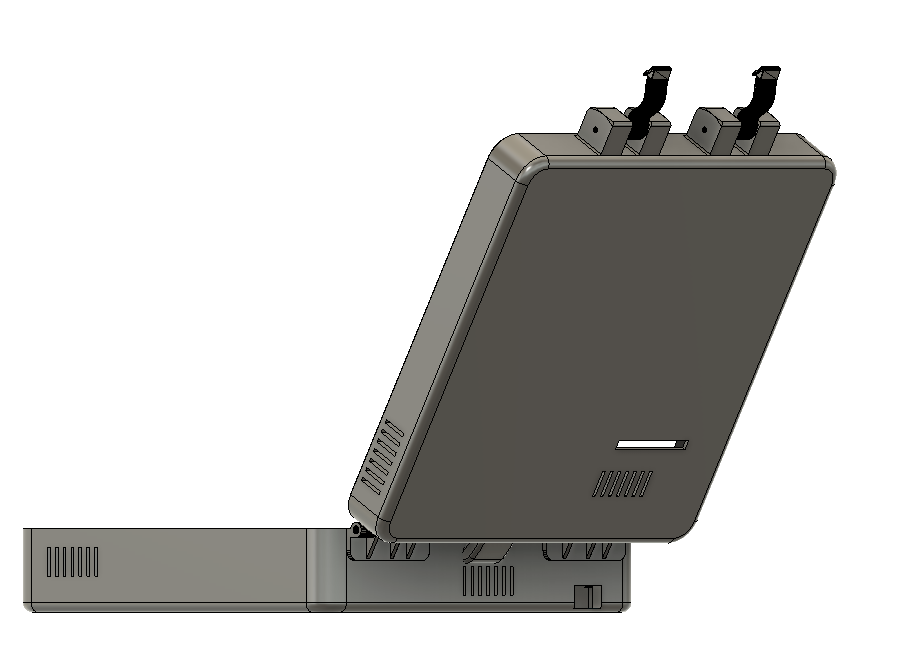

# CyberDeck

A CyberDeck

**Status: ✅ Finished**

---

- [CyberDeck](#cyberdeck)
  - [Gallery](#gallery)
    - [Assembled CyberDeck](#assembled-cyberdeck)
    - [CAD Renders](#cad-renders)
    - [Video](#video)
  - [Mission Definition](#mission-definition)
    - [Purpose](#purpose)
    - [Project Goals](#project-goals)
    - [Unique Characteristics](#unique-characteristics)
  - [Requirements Engineering](#requirements-engineering)
  - [System Architecture](#system-architecture)
    - [Electronics](#electronics)
    - [Architecture](#architecture)
    - [Bill of Materials](#bill-of-materials)
  - [Solarpunk Industrial Design](#solarpunk-industrial-design)
  - [CAD Development](#cad-development)
  - [Thermal Engineering](#thermal-engineering)
  - [Electrical Engineering](#electrical-engineering)
    - [Battery](#battery)
  - [Manufacturing](#manufacturing)
  - [Assembly](#assembly)
  - [Software](#software)
  - [Testing](#testing)
  - [Refinement \& Documentation](#refinement--documentation)

---

## Gallery

### Assembled CyberDeck

| | |
| :---: | :---: |
|  |  |
| Open and running | Closed with the latches locked |

### CAD Renders

| | |
| :---: | :---: |
|  |  |
| Botom and Top covers | Open case with internal layout |
|  |  |
| Empty shell with vents and mounting points | Side view (left) |
|  | |
| Side view (right) | |

### Video

[▶️ Watch the exploded view video (Cyberdeck.avi)](Cyberdeck.avi)

---

## Mission Definition

### Purpose

The purpose of this is to have a distinct portable computer to take to the field and perform on-site prototyping on electronics and tests on field data, at the field.

### Project Goals

- Battery Life goal: 4 hours
- Target weight: 2kg
- Target budget: US$ 300

### Unique Characteristics

- Wood and leather parts
- Free GPIOs for electronics/mechatronics prototyping
- Usage for field quick data analysis / imagery algorithm testing
- Battery display
- Leaf-inspired vent geometry

---

## Requirements Engineering

| Section | Part | Item/Requirement |
| ------- | ---- | ---------------- |
| Hardware | Screen size | 7 " |
| Hardware | Keyboard size | Max of 12 " |
| Hardware | Battery capacity | 10,000 mAh |
| Hardware | Storage | HD of 150GB |
| Hardware | CPU/GPU? | CPU |
| Hardware | Connectivity | Bluetooth, WiFi, Ethernet, USBs, Anthena for Wi-Fi longer range |
| Software | Operating System | Linux, obviously |
| Software | Programming environment | Mostly Python, but if needed, C-family for speedness |
| Software | AI tools | Claude, but if no connection, God help me |
| Software | Robotics tools | GPIO exposed |
| Software | CAD software | FreeCAD |
| Performance | Battery target | 4 hours |
| Performance | Temperature limits | 65 degrees |
| Performance | Boot time | Up to 2 minutes |
| Performance | Weight | 2kg |
| Performance | Noise level | Low to Medium |

---

## System Architecture

### Electronics

* RaspberryPi 5
* 7" Touchscreen display
* Ultra Thin USB Mini Wired Keyboard (11.2")
* 10,000 mAh Power Bank with pass-through charging
* Home-made fan with motor and leaf-inspired 3D printed parts
* USB Wi‑Fi adapter with removable antenna
* Outlet charger
* USB Hub connecting parts
* 128GB External HD + 32GB SD Card

### Architecture

 

**System Block Diagram**

 

**Mechanical Block Diagram**

### Bill of Materials

| Item                                             | Cost (US$) |
| ------------------------------------------------ | ---------- |
| Raspberry Pi 5 8GB                               | 199        |
| 7 Inch Touchscreen IPS DSI Display               | 38.99      |
| Wireless USB WiFi Adapter,with External Antenna  | 4.99       |
| 7-Port USB-C with power delivery                 | 12.69      |
| Ultra Thin USB Mini Wired Keyboard (11.2")       | 10.99      |
| Portable External Solid State Drive 256GB        | 7.79       |
| 32gb SD card                                     | 9.87       |
| 10,000 mAh Power Bank with pass-through charging | 24.99      |
| 1 kg 3D Printer filament                         | 13.99      |
| Case with Dual Cooling Fans                      | 12.99      |
| 15x M3 bolts                                     | -          |
| 2x M3 nuts                                       | -          |
|**Total**                                       |  **336.29**    |

---

## Solarpunk Industrial Design

* **Color pallete:** Light and dark green.
* **Materials:** PLA, "Leather" and Wire protector.
* **Texture Language:** Leaves.
* **Define Modularity:** GPIO pins and Raspberry ports out of structure.

---

## CAD Development

* **Component modeling:** every component measured and modeled, organized in a CAD library.
* **Internal layout:** motherboard and battery arranged, cables routed, mounting points and service access added.
* **Exterior design:** shell, hinges, latches, handle, cable management and removable panels.

---

## Thermal Engineering

* Locate heat sources: Raspberry, Power bank and display
* Airflow simulated and leaf-inspired vents designed on the shell
* Heatsinks: Case with Dual Cooling Fans

---

## Electrical Engineering

### Battery

* Cells and Battery Management System (BMS): 10,000 mAh Power Bank with pass-through charging
* USB-C Power Delivery: Integrated with the power bank, delivering to the raspberry through the USB-C docker energy entry
* Charging circuit: outlet charger connected to the power bank pass-through input
* Battery monitoring: percentage integrated in the power bank display

---

## Manufacturing

Test pieces were printed to verify tolerances and adjust the CAD, followed by the final prints of the enclosure, brackets, vents and accessories. The printable STL files are available in [`3D Prints/`](3D%20Prints/):

| Part | File |
| ---- | ---- |
| Case Top | [Case Top.stl](3D%20Prints/Case%20Top.stl) |
| Case Bottom | [Case Bottom.stl](3D%20Prints/Case%20Bottom.stl) |
| Cover Top | [Cover Top.stl](3D%20Prints/Cover%20Top.stl) |
| Cover Bottom | [Cover Bottom.stl](3D%20Prints/Cover%20Bottom.stl) |
| Handle | [Handle.stl](3D%20Prints/Handle.stl) |
| 2x Latch Arm | [Latch Arm.stl](3D%20Prints/Latch%20Arm.stl) |
| 2x Latch Cam | [Latch Cam.stl](3D%20Prints/Latch%20Cam.stl) |
| Hinge Pin | [hinge_pin.STL](3D%20Prints/hinge_pin.STL) |

---

## Assembly

* **Mechanical:** inserts installed, enclosure assembled and hinges installed.
* **Electronics:** Raspberry Pi, display, battery and cooling installed, and all wiring connected.

---

## Software

* **Operating System:** Linux installed, SSH configured, Docker, Visual Studio and Claude code installed.

---

## Testing

| Area | Tests |
| ---- | ----- |
| Mechanical | Port accessibility, hinge durability, keyboard comfort |
| Electrical | Battery runtime, charging, USB functionality |
| Thermal | CPU stress test, fan performance |
| Field | Outdoor use, backpack transport, programming session, battery endurance |

---

## Refinement & Documentation

After testing, design issues were fixed, cable management improved, cooling optimized, weight reduced and the software configuration refined.